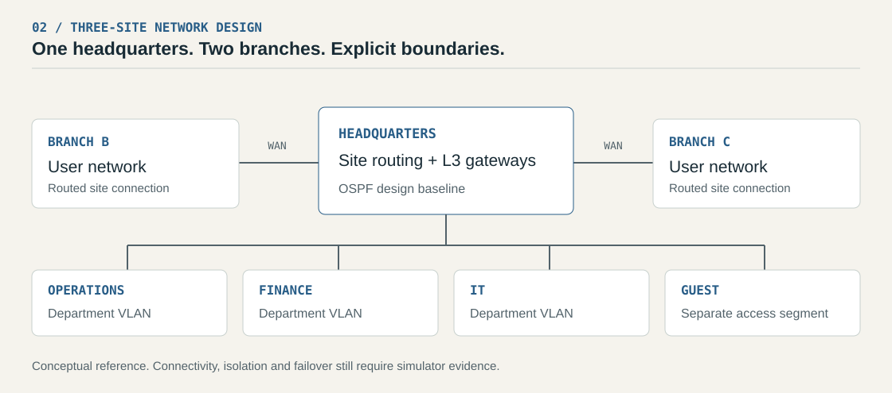
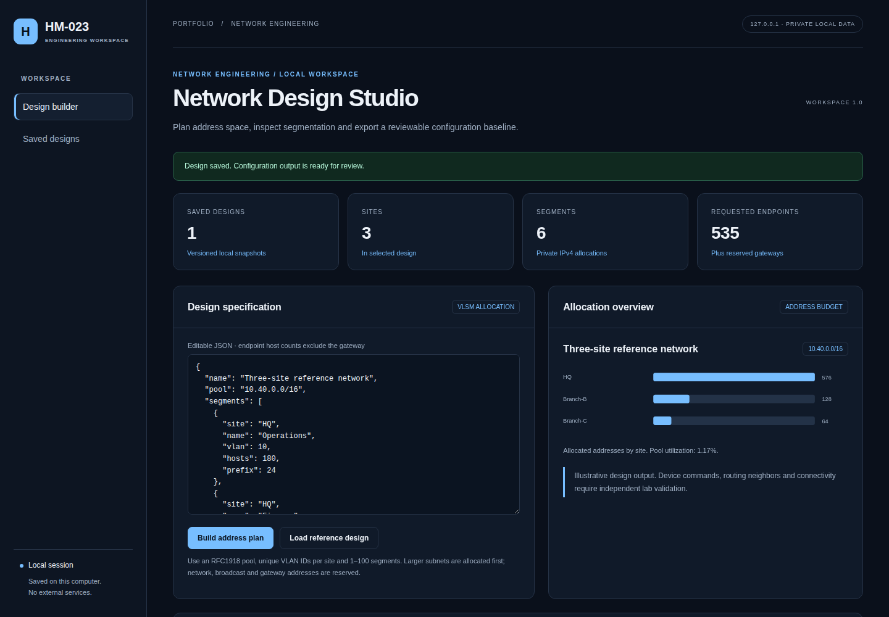

# Enterprise Network Simulation

A three-site network design covering VLAN segmentation, address planning, inter-site routing and failure testing. The public reference uses generic sites and addresses; a Python subnet planner was added later to make the addressing work repeatable.

**Networking · VLSM · VLANs · OSPF**

[Design](docs/architecture.md) · [Address plan](docs/address-plan.md) · [Configuration examples](examples/) · [Verification checklist](docs/verification-plan.md)



*Conceptual design, not a capture from a running simulator.*

## The network design

The design separates departments, guest wireless and services, with routed links between headquarters and two branches. OSPF is the proposed routing baseline. ACL placement and traffic tests matter: putting hosts into different VLANs does not, by itself, enforce isolation.

The [configuration fragments](examples/) illustrate switch VLANs and router OSPF. NAT/PAT, gateway redundancy, spanning tree and link aggregation are design topics in the [case study](docs/reference-case-study.md); their operation has not been demonstrated in this public version.

The original Packet Tracer file remains outside this repository because it needs identifier review and simulator validation. The [verification checklist](docs/verification-plan.md) describes the connectivity, isolation and failover evidence still to collect.

## Later extension: address planner

The Python app allocates non-overlapping VLSM subnets from a private IPv4 pool. Each subnet reserves network, broadcast and one gateway address before counting endpoint capacity.

That detail changes a small but useful edge case: **six endpoints plus a gateway need a /28**, because a /29 has only six usable addresses in total.

The included [planner input](examples/workspace-design.json) requests 535 endpoints across six segments. Running it produces:

| Site / segment | Subnet | Gateway |
|---|---|---|
| HQ / Operations | 10.40.0.0/24 | 10.40.0.1 |
| Branch-B / Users | 10.40.1.0/25 | 10.40.1.1 |
| HQ / Finance | 10.40.1.128/25 | 10.40.1.129 |
| HQ / Guest | 10.40.2.0/25 | 10.40.2.1 |
| Branch-C / Users | 10.40.2.128/26 | 10.40.2.129 |
| HQ / IT | 10.40.2.192/26 | 10.40.2.193 |

This is a separate allocation example from the earlier [illustrative address plan](docs/address-plan.md).

## Try the planner

Requires Python 3.11+; no third-party Python packages. From the repository root:

```powershell
python -m webapp.app
```

Open [localhost:8102](http://127.0.0.1:8102), load the reference design, then build the address plan. You can save a design and export JSON or Cisco-style configuration text. Generated configurations require platform review and additional WAN/security configuration.

```powershell
python -m unittest discover -s tests -v
```

Tests cover subnet overlap, pool exhaustion, gateway reservation, VLAN validation and saved designs. [CI](https://github.com/HM-023/EnterpriseNetworkSimulation/actions/workflows/workspace.yml) also exercises the browser workflow.

<details>
<summary>Planner screenshot and documentation</summary>



[Planner guide](docs/workspace-guide.md) · [Implementation](docs/workspace-architecture.md) · [Verification scope](docs/workspace-verification.md)

</details>

**Status:** the planner runs locally. Simulator connectivity, failover timing and device syntax remain unverified.

[Publication and contribution notes](PUBLICATION_NOTES.md)
