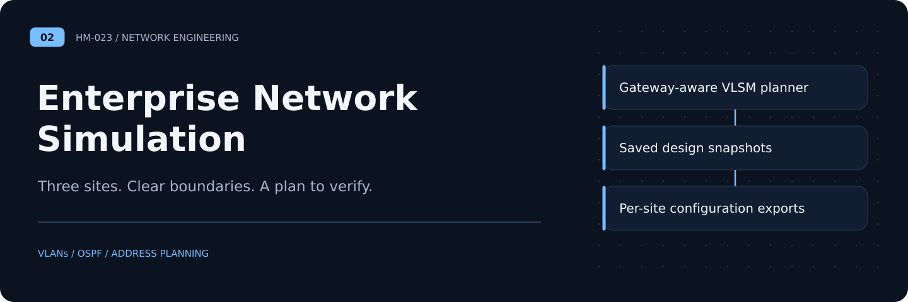
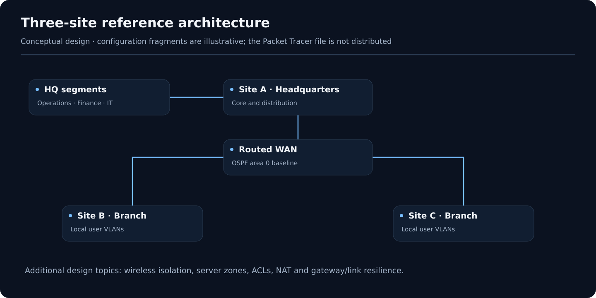

# Enterprise Network Simulation

**Architecture case study** · [Portfolio](https://github.com/HM-023) · [Architecture](architecture.md) · [Address plan](address-plan.md) · [Verification plan](verification-plan.md)

A **fictional three-site enterprise** network architecture case study covering subnet planning, VLAN segmentation, dynamic routing, and availability. The documentation reflects historical design work that used Cisco Packet Tracer; the topology has been rewritten generically for public sharing.

## Architecture

## Design topics

- VLSM and private IPv4 subnet planning for distinct site/department requirements
- VLANs, 802.1Q trunks, inter-VLAN routing and ACL placement
- OSPF area 0 as a proposed dynamic routing baseline
- NAT/PAT and logically isolated server/DMZ zones
- HSRP, STP and EtherChannel as high-availability design patterns
- Wireless segmentation and separate guest access

## Included deliverables

- `docs/architecture.md` — requirements and implementation boundaries
- `docs/address-plan.md` — **illustrative** RFC1918 / RFC5737 addressing
- `docs/verification-plan.md` — Packet Tracer test checklist and Cisco-style verification commands
- `examples/` — sanitized, illustrative device configuration fragments for access VLANs and OSPF routing

## Simulator status

**The original Packet Tracer `.pkt` is deliberately not included.** It contains a historical organization-specific scenario and cannot be verified or sanitized here without opening it in Cisco Packet Tracer. The documentation below is a clean public-facing architectural reference, **not** evidence that all listed commands are configured in a validated live topology. Add a redacted `.pkt` only after manually reviewing the device hostnames, descriptions, saved configurations, credentials, and any labels, and then performing connectivity/failover tests.

## Scope

No corporate affiliation, real production architecture, security guarantee, or operational performance claim is implied. Public configuration examples are conceptual and must be adapted for the target device/software version.

## Collaboration

Based on earlier collaborative network-design work. Original simulator and team-created material require authorization and contribution verification before republication.
